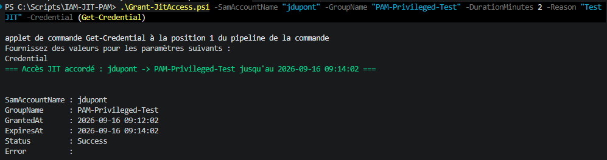
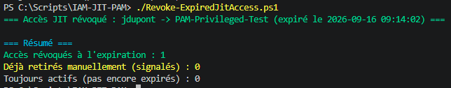
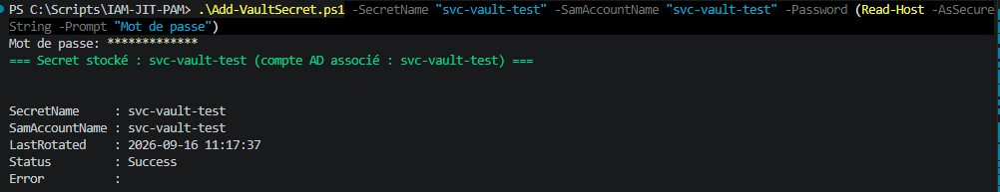
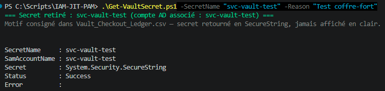
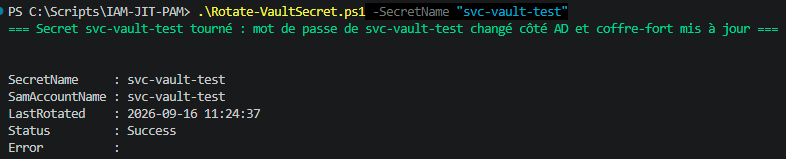

# ⏱️🔒 IAM JIT PAM


Deux volets PAM (Privileged Access Management) du portfolio : l'accès **juste-à-temps** (JIT —
une appartenance à un groupe à privilège accordée pour une durée limitée, révoquée
automatiquement à l'expiration) et le **coffre-fort de secrets** (stockage chiffré d'un mot de
passe de compte de service, retrait tracé, rotation réelle côté AD après usage) — le genre de
mécanismes qu'industrialisent des outils du marché (CyberArk, HashiCorp Vault, BeyondTrust),
construits ici eux-mêmes.

Active Directory n'a pas de mécanisme natif d'appartenance à groupe à durée limitée simple
d'accès — la vraie fonctionnalité PAM de Microsoft (Privileged Access Management dans
Microsoft Identity Manager) nécessite une forêt bastion séparée, hors de portée d'un lab
mono-domaine.

Testé contre le même lab Active Directory (Windows Server 2022, `DC1.society.local`) que le
reste du portfolio — géré au quotidien par
[IAM-JML-Lifecycle](https://github.com/Anne-LaureS/IAM-JML-Lifecycle) pour l'appartenance
standard, ce repo pour l'accès à privilège (temporaire ou secret partagé). Phase 4 (PAM) de
[IAM-Governance-Roadmap](https://github.com/Anne-LaureS/IAM-Governance-Roadmap).

## 1️⃣ Volet 1 — Accès juste-à-temps

Un registre des accords + un script de révocation à exécuter périodiquement — une pratique
réelle et courante en entreprise avant l'adoption d'un outil PAM du marché.

### ⚙️ Les scripts

| Script | Rôle |
|---|---|
| [`Grant-JitAccess.ps1`](Grant-JitAccess.ps1) | Ajoute une personne à un groupe à privilège pour une durée donnée, avec justification obligatoire, et l'enregistre dans le registre |
| [`Revoke-ExpiredJitAccess.ps1`](Revoke-ExpiredJitAccess.ps1) | Retire l'accès de toutes les lignes du registre dont l'expiration est dépassée |

`Revoke-ExpiredJitAccess.ps1` est pensé pour tourner périodiquement (tâche planifiée en
production, ex: toutes les 5 minutes) — dans cette démo, il se relance à la main après avoir
laissé un accès de test expirer.

### ▶️ Utilisation

```powershell
# Accorder un accès de 2 minutes (court exprès, pour observer l'expiration sans attendre)
.\Grant-JitAccess.ps1 -SamAccountName "jdupont" -GroupName "PAM-Privileged-Test" -DurationMinutes 2 -Reason "Test JIT"

# Attendre l'expiration, puis :
.\Revoke-ExpiredJitAccess.ps1
```

Chaque script demande les identifiants du bind AD interactivement (`Get-Credential`) s'ils ne
sont pas fournis via `-Credential`.

**`PAM-Privileged-Test`** est un groupe dédié à ce lab, créé manuellement au préalable dans
`OU=Applications` ou équivalent — ce script ne crée jamais le groupe cible : un groupe à
privilège doit déjà exister avec ses délégations réelles, seule l'appartenance temporaire est
gérée ici.

### 📊 Exemple de bout en bout

Testé pour de vrai contre le lab (`jdupont` → `PAM-Privileged-Test`, 2 minutes) :

```powershell
.\Grant-JitAccess.ps1 -SamAccountName "jdupont" -GroupName "PAM-Privileged-Test" -DurationMinutes 2 -Reason "Test JIT"
```



Un `Revoke-ExpiredJitAccess.ps1` lancé avant l'expiration confirme correctement qu'il n'y a
rien à faire (`Toujours actifs : 1`, `Accès révoqués : 0`) — il ne révoque jamais un accès en
avance. Une fois l'expiration passée :

```powershell
.\Revoke-ExpiredJitAccess.ps1
```



`jdupont` a bien perdu l'appartenance à `PAM-Privileged-Test`, et le registre
([`JIT_Access_Ledger.csv`](JIT_Access_Ledger.csv)) marque la ligne `Expired`.

### 🔐 Sécurité (volet JIT)

- Groupe cible jamais créé automatiquement — seule l'appartenance temporaire est gérée, pas la
  création de périmètres à privilège.
- `-DurationMinutes` et `-Reason` sont obligatoires, sans valeur par défaut : un accès à
  privilège sans limite de temps ni justification n'est pas un JIT, et n'est pas auditable.
- Le registre (`JIT_Access_Ledger.csv`) trace qui a demandé quoi, jusqu'à quand, pourquoi, et
  qui a autorisé — c'est la piste d'audit du dispositif, pas un simple journal technique.
- `Revoke-ExpiredJitAccess.ps1` ne casse jamais sur une ligne : un accès déjà retiré
  manuellement entre-temps est signalé (`ExpiredManually`) plutôt que de faire échouer le
  traitement des autres lignes du lot.

## 2️⃣ Volet 2 — Coffre-fort de secrets

Stockage chiffré (AES-256, natif PowerShell) d'un mot de passe de compte de service, retrait
("checkout") tracé avec justification, et rotation qui change réellement le mot de passe côté
AD — pas seulement côté coffre-fort.

### ⚙️ Les scripts

| Script | Rôle |
|---|---|
| [`Add-VaultSecret.ps1`](Add-VaultSecret.ps1) | Stocke (ou remplace) un secret chiffré, génère la clé de coffre-fort au premier usage |
| [`Get-VaultSecret.ps1`](Get-VaultSecret.ps1) | Retire un secret avec justification obligatoire, journalisé dans un registre d'audit |
| [`Rotate-VaultSecret.ps1`](Rotate-VaultSecret.ps1) | Génère un nouveau mot de passe, le pose sur le compte AD réel, met à jour le coffre-fort |

### ▶️ Utilisation

D'abord créer un compte de service de test dédié (jamais un compte réel) :

```powershell
New-ADUser -Name "svc-vault-test" -SamAccountName "svc-vault-test" -Path "OU=Utilisateurs-Test,DC=society,DC=local" -Server DC1.society.local -Credential (Get-Credential) -Enabled $true -AccountPassword (Read-Host -AsSecureString -Prompt "Mot de passe initial")
```

Puis le cycle de vie complet du secret :

```powershell
# Stocker le secret initial
.\Add-VaultSecret.ps1 -SecretName "svc-vault-test" -SamAccountName "svc-vault-test" -Password (Read-Host -AsSecureString)

# Le retirer pour un usage ponctuel (justification obligatoire)
.\Get-VaultSecret.ps1 -SecretName "svc-vault-test" -Reason "Maintenance planifiée"

# Le faire tourner après usage — change réellement le mot de passe AD
.\Rotate-VaultSecret.ps1 -SecretName "svc-vault-test"
```

### 📊 Exemple de bout en bout

Testé pour de vrai contre le lab (`svc-vault-test`) :

```powershell
.\Add-VaultSecret.ps1 -SecretName "svc-vault-test" -SamAccountName "svc-vault-test" -Password (Read-Host -AsSecureString -Prompt "Mot de passe")
```



Retrait avec justification obligatoire — le secret est rendu en `SecureString`, jamais affiché
en clair sur la console :

```powershell
.\Get-VaultSecret.ps1 -SecretName "svc-vault-test" -Reason "Test coffre-fort"
```



Le retrait est journalisé dans [`Vault_Checkout_Ledger.csv`](Vault_Checkout_Ledger.csv). Rotation
ensuite — change réellement le mot de passe côté AD, pas seulement côté coffre-fort :

```powershell
.\Rotate-VaultSecret.ps1 -SecretName "svc-vault-test"
```



### 🔐 Sécurité (volet coffre-fort)

- **Clé de chiffrement en fichier (`vault.key`), pas un HSM** — limite assumée d'un lab, pas ce
  qu'utiliserait un vrai produit PAM en production (CyberArk/HashiCorp Vault reposent sur un
  HSM ou un service de gestion de clés dédié). La clé n'est jamais régénérée automatiquement :
  une régénération rendrait tous les secrets déjà stockés illisibles.
- `Get-VaultSecret.ps1` ne montre jamais le secret en clair sur la console — il est retourné en
  `SecureString` dans l'objet résultat, à l'appelant de le manipuler s'il en a besoin.
- Chaque retrait est obligatoirement justifié et journalisé (`Vault_Checkout_Ledger.csv`) —
  même discipline que le registre JIT.
- `Rotate-VaultSecret.ps1` change le mot de passe réellement côté AD avant de mettre à jour le
  coffre-fort — un ancien secret retiré avant rotation cesse de fonctionner, ce n'est pas
  cosmétique.
- Chiffrement/déchiffrement AES-256 testés en local (round-trip correct, mauvaise clé rejetée)
  avant tout test contre le lab réel.

## 🔐 Précautions communes

- **Fichiers `.ps1`/`.csv`/`.json` en UTF-8 avec BOM** dès leur création, comme le reste du
  portfolio — Windows PowerShell 5.1 lit mal les accents sans ce marqueur en tête de fichier.
- **Ne jamais utiliser ces scripts (JIT ou coffre-fort) sur Domain Admins ou un compte/groupe
  sensible réel** en dehors d'un périmètre de test dédié.
